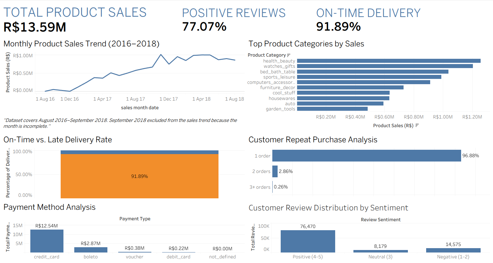

# E-Commerce Intelligence Platform

## Project Overview

An end-to-end e-commerce analytics project built using MySQL 8, Python, and Tableau to analyze sales performance, customer purchasing behavior, payment patterns, product categories, delivery efficiency, and customer reviews.

The project uses the Brazilian Olist e-commerce dataset to transform raw data into structured analytical tables, derive business insights, and present key performance indicators through an interactive Tableau dashboard.

## Business Objectives

- Analyze monthly sales trends and order volume.
- Identify top-performing product categories.
- Evaluate delivery performance against estimated delivery dates.
- Understand repeat purchasing and customer retention.
- Compare payment methods and payment values.
- Analyze customer review sentiment and its relationship with delivery performance.
- Validate data quality and reconcile sales, freight, and payment totals.

## Tools and Technologies

- **MySQL 8:** Data staging, cleaning, joins, aggregations, analysis, and data marts.
- **Python:** Data profiling, data quality checks, staging-data loading, and audit scripts.
- **Tableau Public:** Dashboard creation and visualization.
- **Excel / CSV:** Data inspection and exchange between analytical tools.

## Project Workflow

1. **Data profiling:** Inspected nine source CSV files and assessed record counts, duplicates, missing values, and data quality.
2. **Data staging:** Loaded raw datasets into MySQL staging tables.
3. **Data cleaning:** Created structured analytical tables, standardized timestamps and data types, and handled geolocation duplication.
4. **Data validation:** Checked table grain, keys, missing records, and reconciliation differences.
5. **SQL analysis:** Analyzed sales, categories, payments, retention, reviews, and delivery performance.
6. **Data marts:** Created six analytical tables for consistent reporting.
7. **Visualization:** Built a Tableau dashboard with KPI cards and six analytical views.

## Key Findings

- **Product sales:** Approximately R$13.59 million across the dataset.
- **Delivery performance:** 91.89% of eligible delivered orders arrived on or before the estimated date.
- **Positive reviews:** 77.07% of reviews had scores of 4 or 5.
- **Customer retention:** Approximately 96.88% of customers placed only one order.
- **Top sales categories:** Health and beauty, watches and gifts, and bed, bath and table were among the leading categories by product sales.
- **Delivery and reviews:** Orders delivered on time or early had a higher average review score than late orders. This is an observed association, not proof of causation.

*Figures are based on the dataset and analytical definitions used in this project.*

## Data Quality and Analytical Decisions

- Preserved separate tables for orders, order items, payments, reviews, customers, sellers, products, categories, and geolocation.
- Aggregated geolocation records by ZIP-code prefix to prevent row multiplication during joins.
- Aggregated reviews to order level before comparing review scores with delivery performance.
- Excluded the incomplete September 2018 period from the monthly sales trend visualization.
- Investigated differences between order-item totals and recorded payment totals rather than assuming they were errors.
- Treated positive payment records associated with canceled or unavailable orders as reconciliation exceptions; the dataset does not independently establish refund outcomes.

## Data Marts

| Data mart | Purpose |
|---|---|
| `mart_monthly_sales` | Monthly orders, items, sales, freight, and average order value |
| `mart_category_performance` | Category-level sales and item performance |
| `mart_delivery_performance` | Delivery duration and performance against estimated dates |
| `mart_customer_retention` | Customer order-frequency groups |
| `mart_payment_analysis` | Payment-method distribution and values |
| `mart_review_sentiment` | Review-score sentiment and average ratings |

## Tableau Dashboard

The packaged Tableau workbook is available in the project root:

`BUSINESS_ANALYSIS.twbx`

The dashboard includes:

- Monthly Sales Trend
- Category Performance
- Delivery Performance
- Customer Repeat Purchase Analysis
- Revenue by Payment Method
- Customer Review Distribution

It also highlights product sales, on-time or early delivery rate, and positive review percentage.

### Dashboard Preview



## Repository Structure

```text
ecommerce-intelligence-platform/
├── data/
│   └── raw/                 # Local source data; not committed
├── exports/                 # Generated exports; not committed
├── scripts/
│   ├── profiling/
│   ├── quality_checks/
│   ├── investigations/
│   ├── final_audits/
│   └── load_staging.py
├── sql/
│   ├── Staging/
│   ├── cleaning/
│   ├── validation/
│   ├── analysis/
│   └── data_marts/
├── BUSINESS_ANALYSIS.twbx
├── .gitignore
└── README.md
```

## Dataset

The project uses the Brazilian Olist e-commerce dataset, containing anonymized order, customer, seller, product, payment, review, and geolocation data.

The raw dataset is not included in this repository. Obtain the source files from the original dataset publisher and place them in the expected local data directory before running the scripts.

## Limitations and Future Improvements

- The dataset represents a historical period and does not provide real-time business performance.
- Repeat-purchase analysis describes observed purchasing frequency within the available data, not long-term customer lifetime value.
- Delivery-review relationships are descriptive and should not be interpreted as causal.
- Further improvements could include automated data refreshes, cohort-based retention analysis, customer segmentation, and predictive delivery-risk models.
